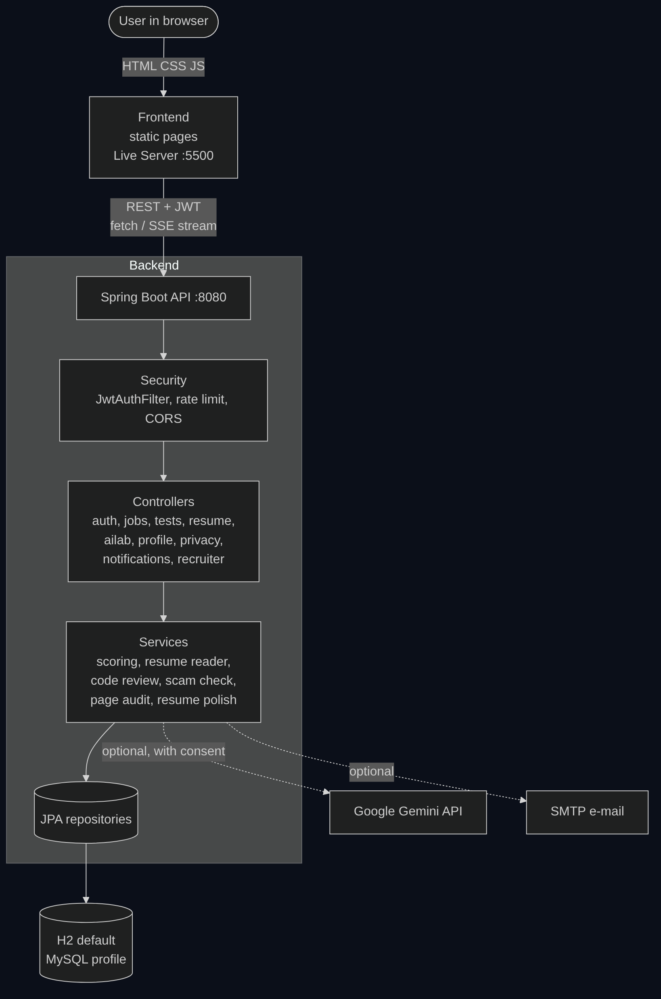
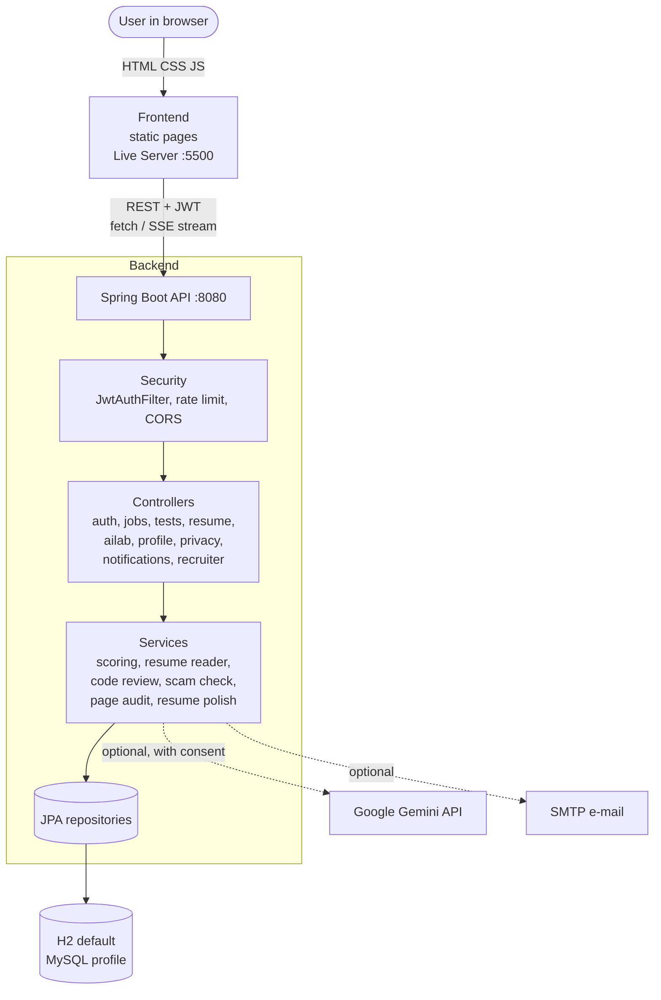

# ApplyRank architecture

The same diagram as text (GitHub draws it automatically):

## How a request travels
1. The browser loads plain HTML, CSS and JavaScript (the frontend repo, no build step).
2. `js/api.js` calls the backend with `fetch`. The login token (JWT) goes in the `Authorization` header.
3. In the backend, `JwtAuthFilter` checks the token (including its version number, so "log out everywhere" works), then the rate limiter and CORS rules run.
4. A controller in `web/` receives the request and calls a service in `service/`.
5. Services use JPA repositories to read and write the database (H2 for testing, MySQL with the `mysql` profile).
6. AI Lab only: if the user agreed, the service sends hidden-data text to Gemini and streams the answer back with Server-Sent Events.

## Key design choices
- **Stateless JWT with a version claim:** logout and password reset raise the user's token version, so old tokens stop working.
- **Privacy first:** emails, phone numbers and links are hidden before any text goes to the AI, resume files are read in memory and never saved, and recruiters see the full email only after a shortlist.
- **Rules first, AI second:** every AI Lab tool gives a useful answer from plain rules, and the AI is an optional extra with a per-user hourly quota.
- **Secrets only as environment variables:** see `.env.example` in the repo root.
